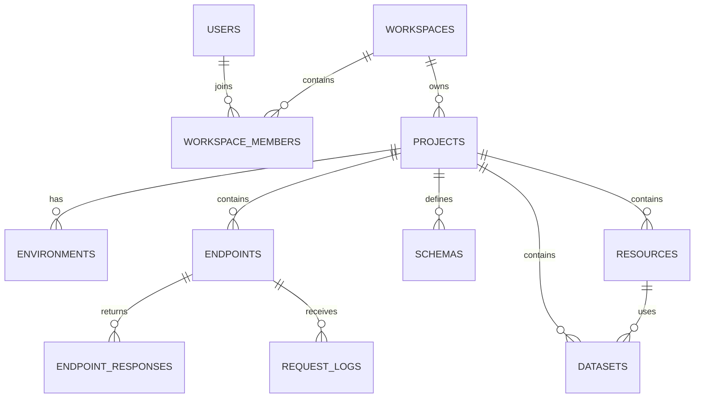

# Developer Workbench
## Product Direction, MVP Scope, PRD & Rust Architecture

**Version:** 1.0  
**Status:** Product definition / implementation baseline  
**Product type:** Open-source developer productivity platform  
**Primary module:** API Studio  
**Tagline:** Build. Test. Simulate. Develop.

---

## 1. Executive Summary

Developer Workbench is an extensible, open-source developer productivity platform that brings API development, mock services, database experimentation, data generation, testing, and everyday engineering utilities into one unified workspace.

The initial release focuses on **API Studio**: a visual REST endpoint generator, persistent mock API server, dynamic mock-data generator, CRUD simulator, request history, and OpenAPI import/export.

The product will support both Web and Desktop experiences, use a hybrid execution model, and offer cloud and self-hosted deployment. The desktop application must support local development without requiring an internet connection.

### Product decisions

| Attribute | Decision |
|---|---|
| Product | Developer Workbench |
| Category | Developer Productivity Platform |
| Primary module | API Studio |
| Platforms | Web + Desktop |
| Target audience | All developers and engineering teams |
| Frontend | React + TypeScript |
| Desktop shell | Tauri 2 |
| Backend | Rust + Axum + Tokio |
| Cloud database | PostgreSQL |
| Local database | SQLite |
| Execution model | Hybrid: browser + Rust runtime |
| Initial API protocol | REST |
| Persistence | Persistent projects and configurations |
| Deployment | Cloud + Self-hosted |
| Distribution | Open source |
| Recommended license | Apache-2.0 |

### Product mission

Give every developer a unified, extensible workspace to build, test, simulate, and experiment with software without needing multiple disconnected tools.

---

## 2. Product Strategy

### 2.1 Positioning

Developer Workbench is not simply a directory of unrelated utilities. It is a modular development environment in which tools share projects, schemas, datasets, configurations, and execution engines.

The product should combine the practical strengths of API clients, mock API tools, SQL playgrounds, data generators, and developer utilities while providing a consistent workspace and portable project format.

### 2.2 Target users

| User | Primary needs |
|---|---|
| Frontend developer | Mock APIs, realistic data, API testing |
| Backend developer | Endpoint design, request validation, response simulation |
| Full-stack developer | Connected API and database workflows |
| QA engineer | Test scenarios, mock responses, reproducible datasets |
| Database engineer | SQL sandbox, schema exploration |
| Software architect | API definitions, schemas, documentation |
| Student / beginner | Safe experimentation and learning |
| Engineering team | Shared workspaces and repeatable environments |

### 2.3 Product principles

1. **Developer-first:** Optimize for real engineering workflows.
2. **Local-first where practical:** Execute lightweight tools locally whenever possible.
3. **Persistent by default:** Save projects, configurations, and workspaces.
4. **Open source:** Users can inspect, extend, deploy, and contribute.
5. **Modular:** Tools work independently but integrate through shared contracts.
6. **Portable:** Projects can be imported and exported across supported platforms.
7. **Secure by design:** Protect credentials, private data, and runtime boundaries.
8. **Progressive complexity:** Keep the first-use experience simple while allowing advanced configuration.

### 2.4 Product modules and long-term vision

| Module | Scope |
|---|---|
| API Studio | Endpoint generator, mock server, REST client, OpenAPI |
| SQL Lab | SQL sandbox, schema tools, ERD, query utilities |
| Data Lab | JSON, CSV, XML conversion and synthetic datasets |
| Code Generator | DTOs, models, API clients, boilerplate |
| Testing Lab | Scenarios, webhooks, WebSocket and GraphQL testing |
| Developer Utilities | JWT, UUID, Regex, Base64, hash, timestamp tools |
| Network Lab | DNS, SSL, HTTP headers, IP/CIDR tools |
| Engineering Productivity | Git, Docker, Kubernetes and configuration generators |

**MVP rule:** Only API Studio and the shared platform foundation are in scope for the first release. Other modules may appear as clearly marked roadmap items, not as incomplete features presented as ready.

---

## 3. MVP Scope

### 3.1 MVP objective

Enable a developer to create a project, define REST endpoints, generate realistic mock data, start a real HTTP mock server, test requests, inspect request history, and export the project.

### 3.2 In-scope features

| Feature | MVP requirement |
|---|---|
| Workspace management | Create, rename, archive, delete |
| Project management | Persistent API projects |
| Endpoint generator | Create and organize REST endpoints |
| HTTP methods | GET, POST, PUT, PATCH, DELETE |
| Request configuration | Headers, path and query parameters, body |
| Response builder | Status, headers, static or dynamic JSON |
| Mock data generator | Configurable synthetic data |
| Mock API server | Run actual HTTP endpoints |
| Dynamic routes | Path parameter matching |
| CRUD simulation | Create, read, update, delete |
| Environments | Development and testing configurations |
| OpenAPI import | Import supported OpenAPI 3.x documents |
| OpenAPI export | Export project API definition |
| cURL import | Convert cURL commands into request definitions |
| Request history | Inspect incoming requests and responses |
| Import/export | Versioned portable project archive |
| Desktop runtime | Local mock server execution |
| Web runtime | Browser UI with server-side Rust execution |

### 3.3 Explicitly out of scope for MVP

- GraphQL and gRPC.
- WebSocket client.
- Advanced performance/load testing.
- Multi-language SDK generation.
- AI-generated endpoints.
- Plugin marketplace.
- Complex enterprise RBAC.
- Billing and subscription management.
- Arbitrary user scripts or native plugin execution.
- General-purpose database query execution.

### 3.4 MVP success metrics

These are initial product targets to validate through testing, not existing performance claims.

| Metric | Target |
|---|---:|
| Create first project | Under 1 minute |
| Create first endpoint | Under 2 minutes |
| Start local mock API | Under 10 seconds |
| Project configuration preservation | 100% in supported round-trip tests |
| Local mock execution | No cloud dependency |
| Project persistence | Survives application restart |
| CRUD simulation | All supported operations pass |
| Core business logic test coverage | 80% target |

---

## 4. Detailed Product Requirements (PRD)

### 4.1 Workspace and project management

Users can create multiple workspaces and projects. A project contains endpoint definitions, schemas, datasets, environments, and runtime settings.

**Functional requirements**
- Create, rename, duplicate, archive, restore, and delete projects.
- Set project name, description, base path, and default headers.
- Autosave changes and show save status.
- Support multiple environments per project.
- Import and export a project.
- Maintain project format version and migration metadata.
- Allow a project to be opened in supported Web and Desktop clients.

**Acceptance criteria**
- A project remains available after restarting the application.
- Duplicating a project produces independent configuration and data.
- Deleting a project requires confirmation.
- Import rejects malformed or unsupported project archives with actionable errors.

### 4.2 Endpoint generator

Users can define endpoints visually without implementing a backend.

**Endpoint properties**
- Name and description.
- HTTP method.
- URL path.
- Enabled/disabled state.
- Path parameters.
- Query parameters.
- Request headers.
- Request body schema and example.
- Response status and headers.
- Static or dynamic response body.
- Delay simulation.
- Conditional response rules.
- Authentication simulation settings.

**Supported methods**
- GET
- POST
- PUT
- PATCH
- DELETE

**Acceptance criteria**
- A user can create, edit, duplicate, enable, disable, and delete an endpoint.
- Duplicate route/method combinations are detected and reported.
- Path parameters are extracted correctly.
- Request schema validation returns understandable errors.
- Response status, headers, and body match the endpoint configuration.

### 4.3 Mock API server

The application must create real HTTP endpoints. Displaying a simulated response only inside the UI does not satisfy this requirement.

Example:

```http
GET http://127.0.0.1:4010/api/users
```

Example response:

```json
{
  "data": [
    {
      "id": "b7e7f6c4-01e5-4d65-95d7-8f54f4f2c201",
      "name": "Alex Morgan",
      "email": "alex@example.test"
    }
  ]
}
```

**Functional requirements**
- Start and stop mock servers.
- Configure host and port.
- Detect port conflicts.
- Register and unregister endpoint routes.
- Match method and URL.
- Resolve path and query parameters.
- Parse request bodies.
- Validate request schemas.
- Execute response rules.
- Return configured status, headers, and body.
- Support configurable delay and error simulation.
- Support multiple isolated mock environments.
- Gracefully shut down listeners when the application exits.

**Acceptance criteria**
- A request from an external HTTP client receives the configured response.
- A route with a path parameter returns the correct resource.
- Disabled endpoints do not respond as active routes.
- Port conflicts are reported without crashing the application.
- Stopping a runtime releases its listener.

### 4.4 Dynamic mock-data generator

Provide configurable synthetic field generators.

| Type | Example |
|---|---|
| UUID | Random UUID |
| Integer / decimal | Configurable range |
| Full name | Synthetic name |
| Email | Synthetic email |
| Phone | Synthetic phone number |
| Address | Synthetic address |
| Boolean | True / false |
| Date / timestamp | Configurable range |
| Company | Synthetic company |
| Enum | User-defined values |
| Custom | User-defined template |

**Requirements**
- Configure record count.
- Configure field types and constraints.
- Support nested JSON objects and arrays.
- Support nullable and unique fields.
- Support relationships between records.
- Support reusable schemas.
- Support deterministic generation using a seed.
- Support preview before saving.
- Support export to JSON and CSV.

For Indonesia-focused test data, provide optional synthetic names, phone formats, and regional address patterns. Never use real personal records as generated data.

### 4.5 CRUD simulation

A resource definition can generate standard CRUD endpoints.

| Method | Endpoint | Behavior |
|---|---|---|
| GET | `/users` | List records |
| GET | `/users/:id` | Retrieve one record |
| POST | `/users` | Create record |
| PUT | `/users/:id` | Replace record |
| PATCH | `/users/:id` | Partially update record |
| DELETE | `/users/:id` | Delete record |

**Requirements**
- Configurable primary key.
- Pagination.
- Filtering.
- Sorting.
- Search.
- Validation rules.
- Relationship references.
- Configurable deletion behavior.
- Persistent data option.
- Clear reset-data operation.

Use an embedded local database or a project-scoped store. Default local development behavior should preserve data across mock server restarts.

### 4.6 Request history and monitoring

Capture:
- Timestamp.
- HTTP method and URL.
- Request headers and query parameters.
- Request body, subject to configured size limits.
- Matched endpoint.
- Response status.
- Response duration.
- Response body, subject to configured size limits.

Provide filters by method, status, endpoint, and time.

**Privacy requirements**
- Redact authorization headers and configured sensitive fields by default.
- Make request-body capture configurable.
- Provide retention limits and clear-history functionality.
- Avoid logging secrets or credentials.

### 4.7 OpenAPI integration

Support import and export of OpenAPI 3.x specifications.

**Import workflow**
1. Upload YAML or JSON.
2. Parse and validate the document.
3. Display errors and warnings.
4. Preview discovered endpoints and schemas.
5. Allow selective import.
6. Map supported definitions into project resources.
7. Generate editable mock response templates.
8. Save the imported project configuration.

**Export workflow**
1. Select project.
2. Generate OpenAPI document.
3. Validate generated document.
4. Download YAML or JSON.

Preserve supported descriptions, parameters, schemas, request bodies, responses, and security definitions. Unsupported constructs must be reported rather than silently discarded.

### 4.8 cURL import

- Parse supported cURL commands.
- Extract method, URL, headers, query parameters, and body.
- Preview the parsed request.
- Allow editing before saving.
- Never execute an imported command automatically.
- Avoid persisting credentials from imported commands without explicit user consent.

### 4.9 Environment management

Users can define Development, Testing, Staging, or custom environments.

Environment values can include:
- Base URL.
- Default headers.
- Non-secret variables.
- Secret variables.
- Runtime port and host settings.

Secrets must be stored securely and excluded from normal exports. Variable interpolation must be explicit and validated.

### 4.10 Import/export

Suggested archive:

```text
workbench-project.zip
└── workbench-project/
    ├── manifest.json
    ├── project.json
    ├── environments/
    │   ├── development.json
    │   └── testing.json
    ├── endpoints/
    │   ├── users.json
    │   └── products.json
    ├── schemas/
    ├── datasets/
    └── openapi/
        └── openapi.yaml
```

**Requirements**
- Versioned format.
- Schema migrations.
- Archive path validation.
- File-size and decompression limits.
- Import preview and validation.
- Export all or selected resources.
- Cross-platform compatibility.
- Credentials excluded by default.
- Round-trip compatibility tests.

---

## 5. UX and Interface Requirements

### 5.1 Design direction

Use a developer-oriented interface inspired by IDEs and API clients.

**Main layout**
- Top bar: workspace, project, environment, account.
- Left sidebar: modules, collections, resources.
- Main area: request editor, endpoint editor, response viewer.
- Right inspector: endpoint properties and configuration.
- Bottom panel: request history, runtime console, server status.

### 5.2 Navigation

- Dashboard
- API Studio
- SQL Lab (planned)
- Data Lab (planned)
- Code Generator (planned)
- Testing Lab (planned)
- Developer Utilities
- Workspace Settings
- Documentation

### 5.3 UX requirements

- Dark and light themes.
- Responsive Web layout.
- Desktop keyboard shortcuts.
- Command palette.
- Endpoint search.
- Drag-and-drop organization.
- JSON syntax highlighting.
- Monaco Editor where appropriate.
- Resizable panels.
- Multiple request tabs.
- Autosave with visible status.
- Clear mock-server status.
- Actionable validation errors.
- Helpful empty states and demo project.
- Accessible keyboard navigation.

### 5.4 Primary user journey

1. Open Workbench and select or create a workspace.
2. Create an API project.
3. Create endpoints manually or import OpenAPI.
4. Configure schemas and mock data.
5. Start a mock server.
6. Test endpoints using the built-in client or an external client.
7. Inspect request history.
8. Export the project or share it through a supported deployment.

---

## 6. Rust Architecture

### 6.1 Architectural approach

Use a **modular monolith** with independently reusable Rust crates and execution engines.

Do not start with microservices. Keep clear module boundaries so components can be extracted later if scale or isolation requirements justify it.

### 6.2 High-level architecture

```text
Web Client (React)             Desktop Client (Tauri 2)
        |                                |
        +---------------+----------------+
                        |
              Application Interface
                        |
                 Rust / Axum API
                        |
        +---------------+----------------+
        |               |                |
  Domain Modules   Execution Layer   Storage Layer
        |               |                |
  Workspace        Mock Engine      PostgreSQL
  Projects         Route Matcher    SQLite
  Endpoints        Validation       File Storage
  Environments     CRUD Engine
  Schemas          Data Generator
  Import/Export    Request Capture
```

### 6.3 Recommended technology stack

| Layer | Technology | Responsibility |
|---|---|---|
| Frontend | React | User interface |
| Language | TypeScript | Frontend logic |
| Build | Vite | Development/build |
| Styling | Tailwind CSS | Styling |
| Components | shadcn/ui | UI components |
| Editor | Monaco Editor | JSON and code editing |
| Server state | TanStack Query | API data |
| Routing | React Router | Navigation |
| Desktop | Tauri 2 | Desktop shell |
| Backend | Rust | Application logic |
| HTTP | Axum | Management API |
| Async | Tokio | Async runtime |
| Serialization | Serde | Data serialization |
| Cloud DB | PostgreSQL | Persistent cloud data |
| Local DB | SQLite | Desktop persistence |
| Database access | SQLx | Async SQL |
| Validation | JSON Schema | Request validation |
| Observability | tracing | Structured logging |
| Deployment | Docker | Self-hosting |
| CI/CD | GitHub Actions | Build and test automation |

### 6.4 Recommended Rust crates

| Crate | Purpose |
|---|---|
| `axum` | HTTP application server |
| `tokio` | Async runtime |
| `serde` | Serialization |
| `serde_json` | JSON |
| `serde_yaml` | YAML |
| `sqlx` | PostgreSQL and SQLite |
| `tower-http` | HTTP middleware |
| `utoipa` | OpenAPI documentation |
| `jsonschema` | JSON Schema validation |
| `uuid` | Identifiers |
| `chrono` | Date/time |
| `tracing` | Logging |
| `thiserror` | Typed errors |
| `anyhow` | Error propagation |
| `argon2` | Password hashing |
| `jsonwebtoken` | JWT operations |
| `validator` | Input validation |

Pin dependency versions and verify compatibility during implementation. Review maintenance, license, and security status before adopting each dependency.

### 6.5 Suggested Rust workspace

```text
crates/
├── workbench-core/
├── workbench-domain/
├── workbench-api/
├── workbench-storage/
├── mock-engine/
├── mock-runtime/
├── data-generator/
├── openapi-engine/
└── project-archive/
```

**Responsibilities**
- `workbench-core`: shared primitives, IDs, configuration, common errors.
- `workbench-domain`: domain entities and business rules.
- `workbench-api`: Axum management API and handlers.
- `workbench-storage`: repositories and database adapters.
- `mock-engine`: route matching, rules, response generation.
- `mock-runtime`: HTTP listener and runtime lifecycle.
- `data-generator`: deterministic synthetic data generation.
- `openapi-engine`: parsing, validation, mapping, generation.
- `project-archive`: project import/export and migrations.

### 6.6 Mock execution pipeline

```text
Incoming HTTP Request
        |
        v
Route Matching
        |
        v
Method Validation
        |
        v
Parameter Extraction
        |
        v
Request Body Parsing
        |
        v
Schema Validation
        |
        v
Execution Rule Evaluation
        |
        v
Mock / CRUD Execution
        |
        v
Response Generation
        |
        v
Request History Capture
        |
        v
HTTP Response
```

The execution engine should be independent of React and the desktop UI.

### 6.7 Separate management API and mock runtime

Keep the management API and mock runtime logically separate.

```text
Management API
  127.0.0.1:8080
  /api/v1/projects
  /api/v1/endpoints

Mock Runtime
  127.0.0.1:4010
  /mock/users
  /mock/products
```

The management API configures projects and runtime instances. The mock runtime handles actual incoming API requests.

This prevents route collisions and supports independent runtime lifecycle management.

### 6.8 Hybrid execution model

| Workload | Execution location |
|---|---|
| JSON formatting | Browser |
| UUID generation | Browser |
| JWT decoding | Browser |
| Regex testing | Browser |
| Mock API server | Local Rust runtime or cloud Rust runtime |
| Dynamic CRUD | Rust runtime |
| Webhook receiving | Rust backend |
| OpenAPI import | Browser preview + Rust validation/persistence |
| Project storage | SQLite / PostgreSQL |
| Request history | Runtime + persistent storage |

For desktop, Tauri should act as a shell around the React frontend. A local Rust host owns the HTTP listener and database connections.

For Web, the Rust backend manages mock runtimes and isolates projects. A separate mock-runtime gateway can be introduced later for externally accessible mock URLs.

### 6.9 Desktop architecture

```text
Desktop Application
├── Tauri Window
│   └── React UI
├── Rust Application Host
│   ├── Workspace Service
│   ├── Project Service
│   ├── Mock Runtime Manager
│   └── Local HTTP Server
└── Local Storage
    ├── SQLite
    ├── Project Files
    └── Request History
```

Requirements:
- Local-only usage without an account.
- Local mock server.
- Persistent projects.
- Import/export.
- Configurable ports.
- Port conflict detection.
- Graceful shutdown.
- Optional cloud synchronization.

Bind local mock servers to `127.0.0.1` by default. Network exposure must require explicit user configuration.

---

## 7. Database Design

### 7.1 Core entities

| Table | Purpose |
|---|---|
| `users` | User accounts |
| `workspaces` | User/team workspaces |
| `workspace_members` | Workspace membership |
| `projects` | API projects |
| `environments` | Project environments |
| `endpoints` | Endpoint definitions |
| `endpoint_parameters` | Path and query parameters |
| `endpoint_headers` | Request/response headers |
| `endpoint_responses` | Response configurations |
| `schemas` | JSON schemas |
| `resources` | CRUD resources |
| `datasets` | Generated/imported datasets |
| `request_logs` | Incoming request history |
| `project_exports` | Export metadata |
| `audit_logs` | Important configuration changes |

### 7.2 Entity relationships



### 7.3 Storage strategy

| Data | Storage |
|---|---|
| Users and workspaces | PostgreSQL |
| Projects and endpoints | PostgreSQL |
| Flexible response configuration | PostgreSQL JSONB |
| Cloud request history | PostgreSQL initially |
| Desktop projects | SQLite |
| Desktop request history | SQLite |
| Large exports | Filesystem or object storage |

Use normalized tables for frequently queried entities and JSONB for flexible endpoint configuration. Avoid storing an entire project in one database column.

---

## 8. Management API Specification

Base path: `/api/v1`

### 8.1 Workspace endpoints

| Method | Path | Purpose |
|---|---|---|
| GET | `/workspaces` | List workspaces |
| POST | `/workspaces` | Create workspace |
| GET | `/workspaces/:id` | Get workspace |
| PATCH | `/workspaces/:id` | Update workspace |
| DELETE | `/workspaces/:id` | Delete workspace |

### 8.2 Project endpoints

| Method | Path | Purpose |
|---|---|---|
| GET | `/projects` | List projects |
| POST | `/projects` | Create project |
| GET | `/projects/:id` | Project details |
| PATCH | `/projects/:id` | Update project |
| DELETE | `/projects/:id` | Delete project |
| POST | `/projects/:id/duplicate` | Duplicate project |
| POST | `/projects/:id/import` | Import project |
| GET | `/projects/:id/export` | Export project |

### 8.3 Endpoint management

| Method | Path | Purpose |
|---|---|---|
| GET | `/projects/:id/endpoints` | List endpoints |
| POST | `/projects/:id/endpoints` | Create endpoint |
| GET | `/endpoints/:id` | Endpoint details |
| PATCH | `/endpoints/:id` | Update endpoint |
| DELETE | `/endpoints/:id` | Delete endpoint |
| POST | `/endpoints/:id/duplicate` | Duplicate endpoint |
| POST | `/endpoints/:id/enable` | Enable endpoint |
| POST | `/endpoints/:id/disable` | Disable endpoint |

### 8.4 Mock server management

| Method | Path | Purpose |
|---|---|---|
| POST | `/projects/:id/mock-servers` | Start server |
| GET | `/projects/:id/mock-servers` | Server status |
| DELETE | `/mock-servers/:id` | Stop server |
| PATCH | `/mock-servers/:id` | Update configuration |
| GET | `/mock-servers/:id/logs` | Request logs |

### 8.5 OpenAPI endpoints

| Method | Path | Purpose |
|---|---|---|
| POST | `/projects/:id/openapi/import` | Import OpenAPI |
| GET | `/projects/:id/openapi/export` | Export OpenAPI |
| POST | `/openapi/validate` | Validate specification |

### 8.6 Environment endpoints

| Method | Path | Purpose |
|---|---|---|
| GET | `/projects/:id/environments` | List environments |
| POST | `/projects/:id/environments` | Create environment |
| PATCH | `/environments/:id` | Update environment |
| DELETE | `/environments/:id` | Delete environment |

### 8.7 API standards

- RESTful resource naming.
- JSON request and response bodies.
- Consistent error response format.
- Pagination for collections.
- Request validation.
- UUID resource identifiers.
- ISO 8601 timestamps.
- API versioning.
- OpenAPI documentation.
- Idempotency for operations where appropriate.

Example error:

```json
{
  "error": {
    "code": "ENDPOINT_NOT_FOUND",
    "message": "The requested endpoint does not exist.",
    "details": [],
    "request_id": "request_uuid"
  }
}
```

---

## 9. Security and Non-Functional Requirements

### 9.1 Security

| Area | Requirement |
|---|---|
| Local runtime | Bind to loopback by default |
| Cloud authentication | Secure session and authentication management |
| Passwords | Argon2id hashing |
| Secrets | Encrypted at rest |
| API keys | Excluded from exports by default |
| Request logs | Redact authorization and sensitive headers |
| Import | Validate files and enforce size limits |
| SQL execution | Isolated execution environment when introduced |
| Mock runtime | Project-level isolation |
| Network | Prevent unintended internal network access |
| CORS | Explicit configurable origins |
| Permissions | Workspace and project access checks |

Additional controls:
- Do not implement arbitrary upstream proxying in MVP.
- Do not allow arbitrary system commands or native code execution.
- Use declarative response rules.
- Limit request and response sizes.
- Apply execution timeouts and resource limits.
- Protect management endpoints from public access.
- Prevent cross-project data access.
- Rate-limit public cloud mock endpoints.
- Require explicit configuration before exposing local servers to a LAN.

### 9.2 Non-functional requirements

| Category | Requirement |
|---|---|
| Performance | Low-overhead mock execution |
| Scalability | Multiple isolated mock environments |
| Reliability | Graceful runtime lifecycle management |
| Portability | Web/Desktop project compatibility |
| Maintainability | Modular Rust codebase |
| Accessibility | Keyboard navigation and accessible controls |
| Availability | Health checks |
| Observability | Structured logs and request tracing |
| Compatibility | Modern browsers and supported desktop OS |
| Data integrity | Transactions and migrations |
| Backup | PostgreSQL backup and restore |

### 9.3 Initial performance targets

- Typical project loading should normally complete within 2 seconds.
- Support at least 100 configured endpoints per project.
- Request history capture must not block response delivery.
- Support configurable concurrency and resource limits.
- Benchmark mock execution on documented hardware and deployment profiles before publishing guarantees.

---

## 10. Open-Source Strategy

### 10.1 License

Recommended license: **Apache License 2.0**.

Reasons:
- Permissive commercial use.
- Modification and redistribution allowed.
- Explicit patent grant.
- Suitable for community contributions.
- Friendly to self-hosted organizational adoption.

Review all third-party dependency licenses and publish a dependency license inventory.

### 10.2 Distribution

| Channel | Purpose |
|---|---|
| GitHub | Source code and community |
| GitHub Releases | Desktop binaries |
| GHCR / container registry | Self-hosted deployment |
| Product website | Documentation and downloads |
| Package managers | Future desktop distribution |
| CLI package | Future automation |

### 10.3 Repository structure

```text
developer-workbench/
├── apps/
│   ├── web/
│   └── desktop/
├── crates/
│   ├── workbench-core/
│   ├── workbench-domain/
│   ├── workbench-api/
│   ├── workbench-storage/
│   ├── mock-engine/
│   ├── mock-runtime/
│   ├── data-generator/
│   ├── openapi-engine/
│   └── project-archive/
├── migrations/
│   ├── postgres/
│   └── sqlite/
├── deployments/
│   ├── docker/
│   └── self-hosted/
├── docs/
├── tests/
│   ├── integration/
│   ├── contract/
│   └── fixtures/
├── scripts/
├── Cargo.toml
├── LICENSE
├── CONTRIBUTING.md
├── CODE_OF_CONDUCT.md
├── SECURITY.md
└── README.md
```

Use a Cargo workspace to share Rust code across the backend, desktop host, and execution runtime.

### 10.4 Plugin architecture

Design module boundaries for plugins, but defer the public marketplace.

Potential future plugins:
- GraphQL Toolkit.
- PostgreSQL Toolkit.
- MySQL Toolkit.
- Redis Toolkit.
- Docker Toolkit.
- Kubernetes Toolkit.
- Additional code generators.

Prefer declarative or sandboxed extension execution. Do not load untrusted native extensions into the primary process.

---

## 11. Testing Strategy

| Test layer | Scope |
|---|---|
| Unit tests | Business rules and generators |
| Integration tests | Database and service operations |
| API tests | Management API |
| Runtime tests | HTTP routing and response generation |
| Contract tests | OpenAPI compatibility |
| Import/export tests | Round-trip compatibility |
| Security tests | Isolation and input validation |
| UI tests | User workflows |
| Desktop tests | Local runtime lifecycle |
| Performance tests | Concurrent mock requests |

### Critical acceptance scenarios

1. Create a project and restart the application; verify persistence.
2. Create a GET endpoint and receive the configured JSON response.
3. Create a dynamic route and verify path parameter matching.
4. Create a POST endpoint and verify request body validation.
5. Generate 100 records and verify pagination.
6. Execute CRUD operations and verify data persistence.
7. Import an OpenAPI specification and export it again.
8. Export a project and import it on another supported platform.
9. Start two mock environments without route collisions.
10. Stop the application and verify local mock listeners shut down safely.

---

## 12. Development Roadmap

| Phase | Deliverable | Priority |
|---|---|---|
| 0 | Repository, design system, architecture | Foundation |
| 1 | Workspaces and project persistence | Critical |
| 2 | Endpoint generator and response builder | Critical |
| 3 | Dynamic Mock Execution Engine | Critical |
| 4 | CRUD and mock data generation | Critical |
| 5 | Request history and environments | High |
| 6 | OpenAPI import/export | High |
| 7 | Desktop integration and local execution | High |
| 8 | Docker self-hosted deployment | High |
| 9 | Documentation and stable release | High |

### Release milestones

**Milestone 1 — MVP API Studio**
- Project management.
- Endpoint generation.
- Mock API server.
- CRUD simulation.
- Mock data generation.
- Request history.

**Milestone 2 — Developer Workbench 1.0**
- Web and Desktop support.
- Import/export.
- OpenAPI integration.
- Self-hosted deployment.

**Milestone 3 — Developer Workbench 1.5**
- SQL Lab.
- Data Lab.
- Developer Utilities.
- Code generation.

**Milestone 4 — Developer Workbench 2.0**
- Plugin system.
- Team collaboration.
- Advanced testing.
- Extensible execution.

Milestones are feature gates, not fixed calendar commitments. Each must pass its acceptance criteria before proceeding.

---

## 13. Definition of Done

- [ ] A developer can install and run the application.
- [ ] A developer can create a persistent workspace.
- [ ] A developer can create multiple API projects.
- [ ] A developer can generate REST endpoints without coding.
- [ ] A developer can configure request and response schemas.
- [ ] A developer can generate synthetic datasets.
- [ ] A developer can start a real mock HTTP server.
- [ ] CRUD endpoints work with persistent mock data.
- [ ] A developer can inspect request history.
- [ ] OpenAPI import/export works for supported documents.
- [ ] Project import/export works across supported platforms.
- [ ] Desktop execution works without an internet connection.
- [ ] Docker self-hosted deployment works.
- [ ] Security and isolation tests pass.
- [ ] Documentation and contribution guidelines are published.

---

## 14. Key Architecture Decisions to Lock

1. **Independent Mock Execution Engine:** Build it as a reusable Rust crate, usable by both Web and Desktop.
2. **Portable Project Format:** Projects created on Desktop must be importable into supported self-hosted and cloud deployments.
3. **Independent Module Boundaries:** SQL Lab and Data Lab should consume shared schemas, datasets, and project infrastructure.
4. **Modular Monolith First:** Avoid microservices until actual scale or isolation requirements justify them.
5. **Local-first Desktop:** Local mock execution and local project storage must not require an account or internet connection.
6. **Safe Runtime Defaults:** Bind local listeners to loopback and require explicit opt-in for network exposure.

## 15. Recommended First Technical Deliverable

Build a working Rust mock server that can:

1. Load endpoint definitions from a persistent project.
2. Match HTTP methods and dynamic paths.
3. Execute configured response rules.
4. Perform CRUD operations against a persistent local store.
5. Return real HTTP responses.
6. Capture request history.
7. Start and stop safely.

Once this engine works, build the visual API Studio around it.

**Recommended repository:** `developer-workbench`

**Recommended first module:** `API Studio`

**Product mission:** One workspace for everything developers need to build, test, debug, and simulate software.
